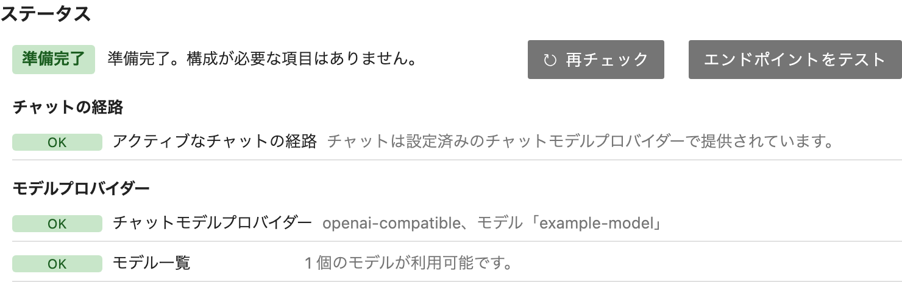
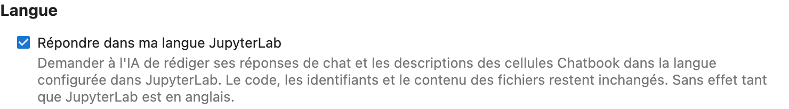

[Notebook Intelligence](https://github.com/plmbr/notebook-intelligence) (NBI) is an AI coding assistant and extensible AI framework for JupyterLab.

Until now, switching JupyterLab to another language left NBI behind. The menus, the launcher, and the file browser changed, but the chat sidebar, the settings, and every message NBI wrote stayed in English. NBI 6.3 follows the language you choose under **Settings → Language**, ships a translation for every language JupyterLab has a language pack for, and can ask the model to reply in that language as well.

This post covers how to turn it on, what gets translated, what stays English on purpose, how right-to-left languages work, and how to fix a translation. That last part matters: the translations were drafted with AI, and none has been reviewed by a native speaker yet.


## Turning it on

There is no NBI setting for the interface language. NBI uses JupyterLab's:

1. Install JupyterLab's language pack for your language, for example `pip install jupyterlab-language-pack-fr-FR`, and restart JupyterLab.
2. Choose the language under **Settings → Language**. JupyterLab reloads the page.

NBI 6.3 ships translations for Arabic, Armenian, Catalan, Chinese (Simplified and Traditional), Czech, Danish, Dutch, Estonian, Finnish, French, German, Greek, Hebrew, Hungarian, Indonesian, Italian, Japanese, Korean, Lithuanian, Norwegian, Polish, Portuguese (Brazil), Romanian, Russian, Spanish, Turkish, Ukrainian, and Vietnamese. That is 29 languages, and each covers all of NBI's roughly 1,000 interface strings. The translations live inside the `notebook-intelligence` package, so nothing extra needs installing beyond the language pack, and they update with NBI.

The language pack is required. JupyterLab only offers a language it has a pack for, and NBI only uses a translation when JupyterLab is actually showing that language. That rule is there to keep NBI's server and its frontend in agreement, so the server does not write French into a page whose frontend is showing English.

## What is translated

All of NBI's own interface is translated:

- the chat sidebar, its modes, buttons, and notices (the `/` and `@` commands themselves stay as typed);
- NBI Settings, including the Claude, ACP, MCP, Skills, Plugins, and Performance tabs;
- Chatbook's cell toolbar, confirm bar, and dialogs, and the notebook toolbar buttons;
- the first-run tour and the command palette entries;
- the text NBI's server writes for you.

A lot of what NBI shows is written by the server, not the browser: the readiness report at the top of NBI Settings, approval cards for Claude and ACP tool calls, chat status and error lines, and the errors a settings action can return. Nearly all of it is translated, in the language of the browser tab that asked. A few pieces still appear in English, such as the approval prompts for MCP and extension tools in agent mode. One server can serve several users in different languages, so each request carries its own.



Numbers, times, and lists follow the language too. The Performance panel writes durations with the local decimal separator, chat timestamps (previously fixed to US English) and the Claude session picker's dates follow JupyterLab's language, and the tour's list of coding agents ("Codex, opencode, and Pi") is joined the way the language joins lists.

## What stays English, on purpose

Some text is left untranslated deliberately:

- **Product and feature names.** Notebook Intelligence, NBI, JupyterLab, Claude, Claude Code, GitHub Copilot, Codex, MCP, ACP, Chatbook, and the launcher's "Coding Agent" section keep their names in every language.
- **What NBI sends to the model.** Prompts NBI builds, tool descriptions, and tool results are English whatever the interface language. The setting in the next section is the one deliberate exception. (A few of NBI's own status lines, such as the confirmation that a new file was created, are now translated, and since they stay in the chat history they can reach the model on later turns.)
- **Logs and error details.** Server logs and exception text stay English, so they can be searched and shared.
- **Code.** Commands, file names, settings keys, environment variables, and keyboard shortcuts appear as written.

A string that has no translation yet appears in English rather than as a blank. Tour text an administrator has customized is shown as written, in every language.

## Replies in your language

Translating NBI's interface still leaves the model answering in English. If you want the replies in your language too, turn on **NBI Settings → General → Language → Reply in my JupyterLab language**. It is off by default.

{: width="700" }

With the setting on, NBI adds one instruction to each chat request. For JupyterLab in German it reads:

> Reply in German (Germany), the user's JupyterLab language. Leave code, identifiers, file names, file contents, commands and quoted output as they are.

The language is named in English, by the name of its JupyterLab language pack, or by its locale code when the pack has no usable English name, as with Norwegian (`no_NO`). The instruction asks for prose in your language and leaves code alone, so a German reply still names `df.groupby` and quotes the traceback as Python printed it.

Where the instruction goes depends on the chat mode:

- **The configured provider** (Copilot, OpenAI-compatible, LiteLLM, Ollama) gets it in the system prompt of each request. It is never stored in chat history, so turning the setting off takes effect on the next message.
- **Claude mode and ACP agents** keep their own conversation, with a system prompt fixed when the session starts, so the instruction travels with each message instead. It is not added to slash commands, and it is stripped from Claude session previews and ACP session titles, so you will not see it in session lists. A conversation that has already seen it may keep answering in your language after you turn the setting off, until you start a new chat.
- **[Chatbook]()** writes its cell descriptions in your language.

Requests that should produce only code never get the instruction: `/newPythonFile`, inline chat edits, and generated cells. While JupyterLab is in English, or the setting is off, the prompts NBI sends are exactly what they were before 6.3.

## Right to left

Arabic and Hebrew read right to left, and JupyterLab leaves the page laid out left to right in every language. An Arabic sentence with an English product name in it can display out of order in a left-to-right box. So in those two languages, NBI's own panels set their direction themselves. The chat sidebar, NBI Settings, the tour, and NBI's dialogs mirror: headings and labels align to the right, the settings tabs move to the right-hand side, and the chat input's buttons swap sides. A few pieces keep their physical layout because they line up with JupyterLab's own: the Chatbook cell toolbar and mode badge, the cell output toolbar, and the tour's arrows.


Text inside a panel follows its own direction. Each block of a chat message decides for itself, so an English paragraph or table inside an Arabic reply still reads left to right. Code blocks, paths in code, and diffs stay left to right. Approval cards keep showing commands exactly in the order they will run, so a command cannot be visually reordered to look like something else.

The screenshot also shows a limit worth knowing about. JupyterLab's own menus and launcher are translated by JupyterLab's language pack, not by NBI, and some packs cover more of JupyterLab than others. In Arabic, much of JupyterLab's own interface is still English, so NBI can be further along than the application around it.

## Help us get the translations right

The translations in 6.3 were drafted with AI. Each one uses the words JupyterLab's own translation already uses for its concepts (notebook, cell, kernel, Launcher), and each was checked mechanically: every placeholder, plural form, and product name survives, and every catalog builds. But a mechanical check is not a native speaker. Each catalog's header says whether it has been reviewed, and for now every one says it has not.

If something reads wrong in your language, the fix is usually one line in one text file. Each language is a standard gettext catalog at `notebook_intelligence/locale/<locale>/LC_MESSAGES/notebook_intelligence.po`, and an entry looks like this:

```po
#: src/components/settings-panel.tsx
msgctxt "settings section"
msgid "Language"
msgstr "Langue"
```

Change only `msgstr`. The `msgctxt` line, where there is one, says what kind of text it is ("approval button", "permission mode", "first-run tour"), which is how the same English word can be translated differently in different places. Keep placeholders like `%1`, Markdown markers, and product names as they are. Then build and check your change from a clone of the repository:

```bash
pip install -e ".[i18n]"
jlpm i18n:compile
```

`i18n:compile` refuses a catalog whose placeholders do not match the English or whose plural forms are malformed, and names the entry. Restart JupyterLab with your language selected to see it.

A pull request with a correction is welcome, and so is one that reviews a whole catalog: add your name to its `Last-Translator` line and update the review note at the top, so the next reader knows a person has checked it. A new language needs a JupyterLab language pack first, then `jlpm i18n:update -l <locale>` starts its catalog. The [translation guide](https://github.com/plmbr/notebook-intelligence/blob/main/docs/translating.md) has the details, and [CONTRIBUTING.md](https://github.com/plmbr/notebook-intelligence/blob/main/CONTRIBUTING.md#translations) covers how strings are marked for translation in the code.

## Try it

Localization ships in NBI 6.3:

```bash
pip install --upgrade notebook-intelligence
pip install jupyterlab-language-pack-fr-FR   # or the pack for your language
```

Restart JupyterLab, choose your language under **Settings → Language**, and open the NBI sidebar. To get replies in your language as well, turn on **NBI Settings → General → Language → Reply in my JupyterLab language**. For a shared deployment, install the language packs your users need into the server's environment; each user then picks their own language. The rest of the release is in the [6.3.0 release notes](https://github.com/plmbr/notebook-intelligence/releases/tag/v6.3.0).
